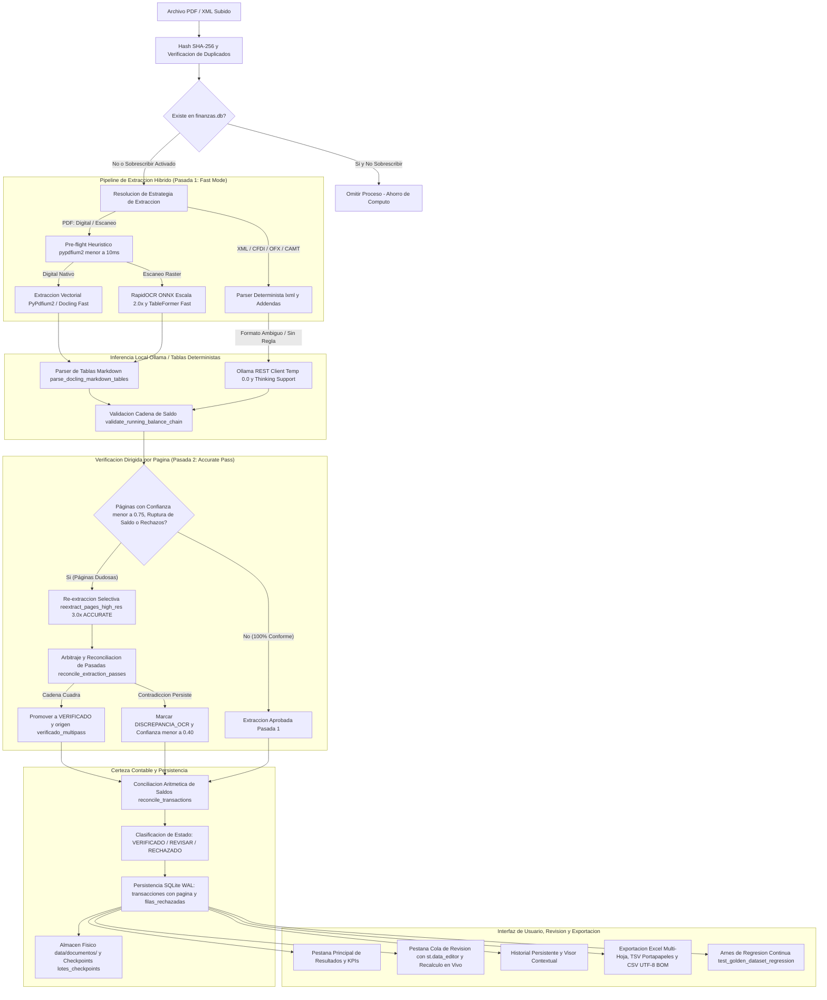

# FinanceOCR - Extractor Financiero Local (PDF y XML)

Aplicacion web 100% local, privada y de alta precision para extraer, estructurar, normalizar, conciliar matematicamente, auditar y exportar transacciones financieras desde estados de cuenta en PDF (digitales nativos y escaneos rasterizados) y comprobantes/estados en XML (CFDI SAT 3.2/3.3/4.0 con complementos y addendas bancarias, OFX, CAMT.053 e ISO 20022).

Incluye verificación dirigida por página (re-extracción selectiva en alta resolución Docling ACCURATE / 3.0x), cola de revisión interactiva en tiempo real, auditoría estructurada de filas rechazadas y arnés de regresión continua contra el Conjunto de Oro (Golden Dataset).

Sin llamadas a internet, sin fuga de datos confidenciales, sin telemetria externa y sin dependencias de APIs comerciales de terceros.

---

## Arquitectura del Sistema y Flujo de Datos



---

## Caracteristicas Principales del Sistema

### 1. Privacidad Total y Procesamiento 100% Local
- Todos los documentos bancarios, comprobantes fiscales y datos financieros se procesan y almacenan exclusivamente en la maquina local.
- Conexion directa mediante HTTP REST con el servidor local de Ollama (http://localhost:11434) empleando modelos abiertos como gemma4:12b, qwen2.5, llama3.1 o deepseek-r1.
- Cero telemetria externa, cero rastreadores y cero transmision de credenciales o estados financieros a nubes externas.

### 2. Estrategias de Extraccion Flexibles (Globales y por Archivo)
El sistema permite configurar estrategias predeterminadas a nivel global en la barra lateral, asi como anulaciones independientes para cada archivo individual del lote:

#### Estrategias para Documentos PDF:
- Maxima Precision (Predeterminada del Sistema): Fuerza la ejecucion de RapidOCR sobre todas las paginas, activa el modo TableFormerMode.ACCURATE para celdas complejas y eleva la escala de renderizado a 2.5x. Ideal para estados de cuenta con sellos de agua, tablas densas o textos comprimidos.
- Automatico: Inspeccion previa con pypdfium2 en menos de 10ms; si detecta texto vectorial omite OCR, mientras que si detecta escaneos activa RapidOCR con tablas en modo rapido (FAST).
- Digital Nativo (Alta Velocidad): Omite por completo el motor de OCR ejecutando extraccion vectorial directa en menos de 1.4s por documento.
- Escaneo Fisico: Fuerza RapidOCR manteniendo el modo de tablas rapido (FAST) y escala 2.0x.
- Personalizado: Permite ajustar manualmente el modo OCR (Automatico, Forzar OCR, Sin OCR), el modo de tablas (Fast vs Accurate) y la escala de imagen (1.5x, 2.0x, 2.5x, 3.0x).

#### Estrategias para Archivos XML:
- Maxima Precision (Determinista Inteligente + Fallback Hibrido LLM): Inspecciona exhaustivamente el arbol XML deterministamente; si el formato es no estandar o ambiguo, lo convierte a Markdown estructurado y ejecuta inferencia con Ollama.
- Determinista Estricto: Ejecuta extraccion puramente matematica y sintactica con latencia instantanea (menor a 50ms).
- Forzar Ollama LLM: Envia la estructura jerarquica del XML a Ollama para clasificacion generativa.

### 3. Parser XML Financiero Exhaustivo y Multi-Nivel
Modulo determinista basado en lxml capaz de procesar:
1. Comprobantes CFDI SAT (v3.2, v3.3 y v4.0):
   - Complemento Estado de Cuenta Bancario (ecb:EstadoDeCuentaBancario): Extrae la totalidad de los movimientos bancarios secundarios, respetando fechas, importes y tipo (CARGO / ABONO).
   - Complemento de Recepcion de Pagos (REP pago10 y pago20:Pagos): Extrae importes abonados, documentos relacionados (DoctoRelacionado), folios y UUIDs fiscales.
   - Complemento Estado de Cuenta Combustible (ecc11 y ecc12): Desglosa compras de gasolina, estaciones de servicio, numeros de operacion y RFCs.
   - Complemento Nomina (nomina12:Nomina): Identifica percepciones, deducciones, pagos netos y patrones.
   - Addendas Bancarias Especializadas (HSBC Mexico, BBVA, Santander, etc.): Extrae movimientos de cuentas de debito y tarjetas de credito (MovimientoDelClienteFiscal y MovimientosDelCliente), omitiendo conceptos informativos ficticios (como comprobantes fiscales de $0.01) y asignando flujos de ingreso/egreso segun las claves bancarias y terminacion de plasticos.
   - Conceptos Estandar de Factura (cfdi:Concepto): Calcula impuestos trasladados (IVA), retenciones y descuentos proporcionales evitando importes parciales antes de impuestos.
2. Open Financial Exchange (OFX / QFX): Parseo determinista de tags STMTTRN, TRNAMT, DTPOSTED, FITID y LEDGERBAL.
3. ISO 20022 CAMT XML (camt.052, camt.053, camt.054): Deteccion de Ntry, montos Amt, indicadores de credito/debito (CRDT / DBIT) y detalles de contraparte.
4. Excel SpreadsheetML XML (urn:schemas-microsoft-com:office:spreadsheet): Conversion de hojas tabulares XML antiguas a tablas Markdown legibles.
5. XML Financiero Generico: Deteccion heuristica de nodos repetitivos (movimiento, transaccion, operacion, pago, registro) para extraccion directa o conversion tabular.
6. RFC del Titular: Campo configurable por archivo y global que invierte automaticamente la clasificacion del flujo (si el RFC del usuario coincide con el emisor clasifica como ingreso, si coincide con el receptor como egreso).

### 4. Inferencia con LLM Optimizada y Chunking Bounded
- Compacting de Espacios en Tablas: Elimina el relleno excesivo de espacios en blanco generado por Docling TableFormer, reduciendo la longitud de lineas de ~600 caracteres a ~60 caracteres sin alterar la integridad estructural.
- Chunking Limitado y con Preservacion de Encabezados: Divide tablas extensas en bloques acotados (max_chunk_chars=1800, max_table_rows=6), reinyectando los encabezados originales en cada fragmento para que el LLM nunca pierda el contexto de las columnas.
- Filtro Pre-Flight de Bloques (menor a 1ms): Inspeccion por expresiones regulares de fechas y montos que descarta paginas legales, avisos de privacidad y publicidad antes de invocar a Ollama, reduciendo el consumo de computo y tiempo en mas de un 70%.
- Contexto de Ano del Estado de Cuenta (extract_statement_year): Detecta el ano fiscal de cabecera (ej. 2024) y lo suministra al prompt para que transacciones con fechas incompletas (ej. 15 ENE) se resuelvan deterministamente.
- Temperatura 0.0 y Modo Anti-Bucles: Configurado con temperatura 0.0 para maxima determinacion y reproducibilidad en la extraccion contable, permitiendo un razonamiento estructurado y compatible con modelos que emiten tokens think.
- Limpieza y Extraccion Robusta de JSON (clean_and_parse_llm_json): Extrae bloques JSON delimitados por markdown o tokens de pensamiento, con mecanismo de salvamento por regex ante respuestas incompletas.
- Desduplicacion de Frontera entre Fragmentos: Elimina transacciones duplicadas generadas en los cortes de pagina preservando movimientos gemelos legitimos del mismo dia.
- Reintentos con Retroceso Exponencial: Hasta 3 intentos automaticos ante desconexiones de red, sobrecargas o respuestas HTTP 429/5xx.

### 5. Certeza Contable: Conciliacion Aritmetica de Saldos
El modulo reconcile_transactions verifica la integridad matematica de la extraccion:
- Deteccion Automatica de Saldos: Extrae mediante regex y atributos XML el saldo_inicial y el saldo_final declarados por el banco.
- Formula de Cuentas de Debito / Cheques:
  Saldo Final Calculado = Saldo Inicial + Ingresos - Egresos
- Formula de Tarjetas de Credito:
  Saldo Final Calculado = Saldo Inicial - Ingresos (Pagos) + Egresos (Cargos/Compras)
- Estados de Conciliacion:
  - Conciliado Exacto: Discrepancia menor o igual a $0.01 MXN.
  - Discrepancia Detectada: Muestra la diferencia monetaria exacta para alertar sobre movimientos no leidos o comisiones bancarias ocultas.
  - Sin Saldos Declarados: Indicador informativo si el documento carece de resumen de saldos.

### 6. Puntos de Control (Checkpoints) y Reanudacion Automatica
- Registro atomico del progreso de lotes en la tabla lotes_checkpoints de SQLite y redundancia en data/checkpoint_active.json.
- Si un lote de multiples archivos se interrumpe por error de hardware, timeout de Ollama o apagado del sistema, los archivos previamente procesados permanecen resguardados.
- Al reiniciar, la interfaz muestra una tarjeta de alerta con dos opciones de recuperacion inmediata:
  - Reanudar automaticamente donde se quedo: Continua el procesamiento a partir del archivo fallido sin reprocesar los ya completados.
  - Omitir archivo y continuar: Salta el archivo problematico y prosigue con los restantes.

### 7. Resguardo Fisico Permanente y Visor de Documentos
- Los archivos PDF y XML procesados se copian de forma permanente en data/documentos/ con prefijos criptograficos SHA-256 de 16 caracteres ({hash[:16]}_{safe_filename}) para evitar colisiones.
- Visor Contextual Integrado:
  - PDF: Selector interactivo de paginas, zoom de renderizado (0.75x a 1.5x) y cuadricula de miniaturas completas.
  - XML: Visor de codigo con resaltado de sintaxis XML y numeracion de lineas.
  - Descarga: Boton para recuperar el archivo binario original en cualquier momento.

### 8. Telemetria de Hardware y Cronometro de Etapas
- Monitor local en tiempo real (telemetry.py) ejecutado en menos de 50ms mediante psutil y nvidia-smi:
  - CPU: Uso porcentual instantaneo, hilos logicos y nucleos fisicos.
  - Memoria RAM: Consumo en GB, total disponible y porcentaje de utilizacion.
  - GPU NVIDIA: Deteccion de tarjeta, porcentaje de carga, VRAM usada/total y temperatura en grados Celsius.
- Cronometro de Etapas (StageStopwatch): Desglose temporal preciso por fases:
  - Estructura XML / CFDI
  - Docling y RapidOCR
  - Inferencia Ollama
  - Normalizacion y Persistencia

### 9. Historial Persistente, Filtros Indexados y Exportacion Excel
- Pestana Fija de Historial: Permite consultar la base de datos sin necesidad de volver a cargar archivos.
- Filtros Combinados: Rango de fechas (fecha_desde / fecha_hasta), tipo de flujo (Ingreso, Egreso, Todos), estado de cuenta origen y buscador textual por palabra clave.
- KPIs Dinamicos: Recalculo en vivo de Ingresos, Egresos y Balance Neto del conjunto filtrado.
- Exportacion Flexible:
  - Copiar al Portapapeles (TSV): Boton con JavaScript inyectado para pegar directo con Ctrl + V en Excel sin desfase de columnas.
  - Descarga Excel (.xlsx): Generacion con openpyxl en hojas separadas para Ingresos y Egresos.
  - Descarga CSV: Codificacion UTF-8 con BOM (utf-8-sig) para compatibilidad nativa con acentos y caracteres especiales en Windows.
- Auditoria y Purga: Panel para listar todos los estados de cuenta, inspeccionar sus paginas y eliminarlos en cascada (base de datos y archivo fisico en disco).

### 10. Verificación Dirigida por Página y Multipass (Fase 4)
- **Detección Automática de Páginas Dudosas (`identify_low_confidence_pages`):** Identifica y aisla exclusivamente las páginas que contienen filas con `confianza < 0.75`, `estado_revision == "REVISAR"`, rupturas en la cadena secuencial de saldo (`saldo_prev +- importe != saldo_renglon`), filas rechazadas o cobertura de página `< 0.99`.
- **Segunda Pasada de Alta Resolución (`reextract_pages_high_res`):** Ejecuta una instancia secundaria cacheada de Docling con `TableFormerMode.ACCURATE`, `images_scale=3.0` y OCR de página completa forzado exclusivamente sobre las páginas dudosas, reduciendo drásticamente el costo de cómputo en comparación con reprocesar el documento completo.
- **Arbitraje y Reconciliación Multipasada (`reconcile_extraction_passes`):**
  - Si la pasada 2 logra cuadrar la cadena de saldo con tolerancia `<= 0.01`, promueve automáticamente las filas a `VERIFICADO`, actualiza `origen = "verificado_multipass"` y recalcula la confianza a `1.0`.
  - Si ambas pasadas difieren y ninguna cuadra la cadena, marca las filas con `DISCREPANCIA_OCR`, reduce la confianza a `<= 0.40` y almacena las anotaciones de auditoría.
- **Trazabilidad de Páginas:** Cada transacción conserva su número de página de origen (`pagina: int`) en memoria, base de datos y exportaciones.

### 11. Cola de Revisión Interactiva y Auditoría de Filas Rechazadas (Fase 4)
- **Pestaña "⚠️ Cola de Revisión" en Interfaz:**
  - Filtro dedicado para transacciones en estado `REVISAR` y `DISCREPANCIA_OCR`.
  - Editor interactivo en vivo (`st.data_editor`) que permite modificar tipo contable e importe.
  - Botón de **Recálculo Aritmético en Vivo** que evalúa instantáneamente `ReconciliacionResultado` antes de confirmar la persistencia.
  - Guardado atómico en SQLite actualizando la base de datos local.
- **Auditoría Estructurada de Filas Rechazadas (`filas_rechazadas`):**
  - Registra las líneas que no superaron la validación de esquemas, con el motivo (`validacion_esquema`, `importe_cero`, `fecha_invalida`), datos crudos y error tipificado, impidiendo la pérdida silenciosa de renglones.

### 12. Conjunto de Oro y Arnés de Regresión Continua (Fase 5)
- **Conjunto de Oro (`tests/fixtures/golden_dataset/`):** Base de benchmark con verdad absoluta verificada manualmente sobre 4 escenarios financieros reales:
  1. `case_01_bbva_debito_digital`: Débito digital con cadena de saldos secuencial perfecta.
  2. `case_02_banamex_credito_comisiones`: Tarjeta de crédito con intereses, anualidad, IVA y pagos recibidos.
  3. `case_03_santander_fechas_sin_anio_oxxo_gemelas`: Fechas sin año con salto de año (2023 -> 2024) y compras gemelas idénticas en OXXO preservadas sin desduplicación errónea.
  4. `case_04_hsbc_sobregiro_negativo`: Cuentas con sobregiro y saldo deudor negativo (-$1,500.00).
- **Métricas de Evaluación (`evaluate_against_golden`):**
  - `precision_filas`, `recall_filas`, `f1_filas` sobre clave compuesta `(fecha_iso, importe, tipo)`.
  - `exactitud_tipo`: porcentaje de coincidencia de flujo sobre filas con fecha e importe idénticos.
  - `falso_verificado`: `True` si un documento con discrepancias o errores se clasifica como `VERIFICADO`.
- **Compuerta de Calidad en CI/Pytest (`test_golden_dataset_regression`):**
  - Tasa de `falso_verificado == 0` (0% falsos positivos de verificación).
  - `f1_filas >= 0.99` y `exactitud_tipo == 1.0` en casos digitales/deterministas.

---

## Matriz de Validacion de Datos e Integridad

| Dimension | Mecanismo de Validacion | Comportamiento / Garantia |
|---|---|---|
| Importes Monetarios | Pydantic field_validator mode='before' | Limpia $, MXN, USD, CR, DR, CARGO, ABONO, comas y parentesis contables. Normaliza a float absoluto positivo. |
| Tipo de Flujo | TipoTransaccion(str, Enum) y SQLite CHECK | Restriccion estricta a 'ingreso' o 'egreso'. Dispara ValidationError y sqlite3.IntegrityError ante valores anomalos. |
| Trazabilidad de Página | Campo `pagina: int` en modelos y BD | Asocia cada movimiento a su página física para visualización y verificación dirigida. |
| Campos Obligatorios | Esquema Pydantic (fecha, concepto, importe, tipo) | Ausencia de cualquier atributo esencial rechaza el registro antes de tocar el almacenamiento. |
| Auditoría de Rechazos | Tabla `filas_rechazadas` y función `auditar_fila_rechazada` | Preserva líneas fallidas con motivo y datos crudos para auditoría en UI. |
| Integridad Relacional | SQLite PRAGMA foreign_keys = ON y CASCADE | Clave foranea en transacciones.archivo_id y filas_rechazadas.archivo_id con purga en cascada. |
| Transaccionalidad Atomica | Context manager db_session() con commit/rollback | Los lotes de transacciones se confirman en bloque. Si ocurre un fallo, se ejecuta rollback completo sin escrituras huerfanas. |
| Prevencion de Inyeccion SQL | Consultas parametrizadas con placeholders ? | Busquedas por texto, rangos de fecha y filtros de archivo nunca concatenan cadenas SQL crudas. |
| Normalizacion de Fechas | Expresiones regulares en date_utils.py | Convierte formatos DD/MM/YYYY, DD-MM-YY, DD de Mes del YYYY, YYYYMMDD e ISO 8601 a YYYY-MM-DD. |
| Conciliacion de Saldos | Algoritmo contable en utils.reconcile_transactions | Verifica si el balance de apertura mas ingresos menos egresos coincide con el saldo de cierre con tolerancia menor o igual a 0.01. |
| Clasificación de Estado | Función `clasificar_estado_documento` | Clasifica deterministamente en VERIFICADO, REVISAR o RECHAZADO según saldo, cobertura y rechazos. |
| Deteccion Criptografica | Hash SHA-256 sobre el contenido binario | Impide duplicar estados de cuenta ya procesados salvo que se active explicitamente overwrite=True. |

---

## Esquema Completo de la Base de Datos SQLite (data/finanzas.db)

El sistema utiliza SQLite en modo WAL (Write-Ahead Logging) con verificacion de claves foraneas activada y migraciones no destructivas automaticas:

```sql
PRAGMA foreign_keys = ON;
PRAGMA journal_mode = WAL;
PRAGMA synchronous = NORMAL;

-- Tabla de Estados de Cuenta y Comprobantes Procesados
CREATE TABLE IF NOT EXISTS archivos_procesados (
    id INTEGER PRIMARY KEY AUTOINCREMENT,
    nombre_archivo TEXT NOT NULL,
    hash_sha256 TEXT NOT NULL UNIQUE,
    tipo_archivo TEXT NOT NULL,                -- 'pdf' o 'xml'
    fecha_procesamiento TEXT NOT NULL,          -- Formato ISO: YYYY-MM-DD HH:MM:SS
    total_transacciones INTEGER NOT NULL DEFAULT 0,
    rango_fecha_inicio TEXT,                   -- YYYY-MM-DD
    rango_fecha_fin TEXT,                      -- YYYY-MM-DD
    ruta_archivo TEXT,                         -- Ruta absoluta en data/documentos/
    tamano_bytes INTEGER,                      -- Tamano fisico en bytes
    saldo_inicial REAL,                        -- Saldo de apertura declarado
    saldo_final REAL,                          -- Saldo de cierre declarado
    diferencia_conciliacion REAL,              -- Discrepancia matematica calculada
    conciliado INTEGER,                        -- 1: Conciliado exacto, 0: Discrepancia, NULL: Sin saldos
    estado_conciliacion TEXT,                  -- 'VERIFICADO', 'REVISAR', 'RECHAZADO'
    modo_contable TEXT,                        -- 'debito', 'credito', 'ambiguo'
    cobertura REAL,                            -- Cobertura calculada de renglones capturados
    metricas_json TEXT                         -- Telemetria y desglose de ejecucion en JSON
);

-- Tabla de Transacciones Individuales
CREATE TABLE IF NOT EXISTS transacciones (
    id INTEGER PRIMARY KEY AUTOINCREMENT,
    archivo_id INTEGER NOT NULL,
    fecha TEXT NOT NULL,                        -- YYYY-MM-DD
    concepto TEXT NOT NULL,
    importe REAL NOT NULL,
    descripcion TEXT,
    tipo TEXT NOT NULL CHECK(tipo IN ('ingreso', 'egreso')),
    confianza REAL DEFAULT 1.0,
    origen TEXT DEFAULT 'llm',                  -- 'llm', 'determinista_tabla', 'xml', 'verificado_multipass'
    linea_origen TEXT DEFAULT '',
    saldo_renglon REAL,
    estado_revision TEXT DEFAULT 'pendiente',   -- 'VERIFICADO', 'REVISAR', 'DISCREPANCIA_OCR'
    pagina INTEGER DEFAULT 1,                   -- Número de página origen en el documento
    FOREIGN KEY (archivo_id) REFERENCES archivos_procesados(id) ON DELETE CASCADE
);

-- Tabla de Auditoría de Filas Rechazadas
CREATE TABLE IF NOT EXISTS filas_rechazadas (
    id INTEGER PRIMARY KEY AUTOINCREMENT,
    archivo_id INTEGER NOT NULL,
    linea_origen TEXT,
    datos_crudos TEXT,
    motivo TEXT,                                -- 'validacion_esquema', 'importe_cero', 'fecha_invalida'
    detalle_error TEXT,
    pagina INTEGER DEFAULT 1,
    created_at TIMESTAMP DEFAULT CURRENT_TIMESTAMP,
    FOREIGN KEY (archivo_id) REFERENCES archivos_procesados(id) ON DELETE CASCADE
);

-- Tabla de Puntos de Control y Reanudacion de Lotes
CREATE TABLE IF NOT EXISTS lotes_checkpoints (
    batch_id TEXT PRIMARY KEY,
    estado TEXT NOT NULL,                       -- 'in_progress', 'interrupted', 'completed'
    archivos_totales INTEGER NOT NULL,
    archivos_completados TEXT NOT NULL,         -- JSON Array de nombres de archivo
    archivo_fallido TEXT,
    ultimo_error TEXT,
    configuraciones TEXT,                       -- JSON Object con opciones del lote
    fecha_actualizacion TEXT NOT NULL
);

-- Indices B-Tree para optimizacion de consultas (<5ms)
CREATE INDEX IF NOT EXISTS idx_transacciones_fecha ON transacciones(fecha);
CREATE INDEX IF NOT EXISTS idx_transacciones_concepto ON transacciones(concepto);
CREATE INDEX IF NOT EXISTS idx_transacciones_tipo ON transacciones(tipo);
CREATE INDEX IF NOT EXISTS idx_transacciones_archivo ON transacciones(archivo_id);
CREATE INDEX IF NOT EXISTS idx_transacciones_pagina ON transacciones(pagina);
CREATE INDEX IF NOT EXISTS idx_filas_rechazadas_archivo ON filas_rechazadas(archivo_id);
CREATE INDEX IF NOT EXISTS idx_archivos_nombre ON archivos_procesados(nombre_archivo);
CREATE INDEX IF NOT EXISTS idx_archivos_hash ON archivos_procesados(hash_sha256);
CREATE INDEX IF NOT EXISTS idx_checkpoints_estado ON lotes_checkpoints(estado);
```

---

## Estructura Modular del Proyecto

```
Finance/
├── .agents/                    # Reglas del equipo y configuraciones
│   └── rules/team.md           # Simulacion de roles Senior Squad (PM, ARCH, UX/UI, DEV, QA, TW)
├── data/                       # Almacenamiento local persistente
│   ├── finanzas.db             # Base de datos SQLite (tablas indexadas en WAL)
│   ├── checkpoint_active.json  # Redundancia en disco del checkpoint de lote activo
│   └── documentos/             # Copias fisicas de PDFs y XMLs con prefijo SHA-256
├── documentation/              # Documentacion tecnica especializada
│   ├── architecture.md         # Arquitectura detallada, diagramas y contratos modulares
│   └── TLDR.md                 # Resumen ejecutivo y contexto rapido del proyecto
├── tests/                      # Paquete de pruebas y fixtures
│   ├── fixtures/               # Comprobantes y addendas oficiales de prueba
│   │   ├── dummy_xml_debito.xml
│   │   └── dummy_xml_credito.xml
│   └── __init__.py
├── app.py                      # Interfaz Streamlit, pestanas, visualizadores y control de lotes
├── database.py                 # Capa de acceso a datos (DAL), migraciones, WAL y checkpoints
├── date_utils.py               # Normalizador de fechas en espanol y detector de ano fiscal
├── llm_client.py               # Cliente REST Ollama, chunking bounded, compactacion y backoff
├── models.py                   # Modelos canonicos Pydantic y enumeraciones de flujo
├── parsers.py                  # Extraccion PDF (Docling/RapidOCR/PyPdfium2) y XML (CFDI/OFX/CAMT)
├── telemetry.py                # Telemetria de hardware (CPU/RAM/GPU) y StageStopwatch
├── utils.py                    # Exportacion Excel/CSV, portapapeles TSV y conciliacion de saldos
├── requirements.txt            # Dependencias del entorno virtual
├── test_data_validation.py     # Suite de validacion de esquemas y restricciones SQL (10 tests)
├── test_database.py            # Suite de persistencia, hashes, borrado en cascada y checkpoints (13 tests)
├── test_ocr_optimization.py    # Suite de heuristica digital, cache y renderizado PDF (4 tests)
├── test_system.py              # Suite de integracion end-to-end y parsers de comprobantes (20 tests)
└── test_telemetry.py           # Suite de telemetria de sistema y cronometro (3 tests)
```

---

## Suite de Pruebas Automatizadas (78 Tests)

El proyecto cuenta con 78 pruebas unitarias y de integracion totalmente automatizadas con cobertura rigurosa en todas las capas del sistema y cero regresiones:

### Desglose por Archivo de Pruebas:

1. `test_data_validation.py` (15 tests):
   - Matriz de sanitización de importes con símbolos de moneda, comas y formatos contables con signo y paréntesis.
   - Forzamiento estricto del Enum `TipoTransaccion`.
   - Validación de campos requeridos en esquemas Pydantic.
   - Restricciones SQLite `CHECK(tipo IN ('ingreso', 'egreso'))`.
   - Restricciones de integridad referencial con claves foráneas.
   - Restricción de unicidad de hash SHA-256.
   - Reversión atómica (rollback) ante excepciones en inserciones por lote.
   - Resiliencia e inmunidad contra inyección de código SQL malicioso en filtros.
   - Matriz exhaustiva de fechas bancarias en español (12 meses, mayúsculas, minúsculas, abreviaturas y preposiciones).
   - Fechas bancarias sin año y resolución de saltos de periodo fiscal.
   - Normalización de flujo de efectivo y preservación de candidatos.
   - Auditoría estructurada de filas rechazadas (`auditar_fila_rechazada`) y métricas de captura.
   - Puntuación de confianza por fila (`compute_row_confidence`) y matriz de penalizaciones.
   - Integridad estructural de exportaciones a Excel (ZIP PK), CSV con BOM y TSV sin columnas internas.
   - Certeza y cálculo de `ReconciliacionResultado`.

2. `test_database.py` (19 tests):
   - Inicialización idempotente del esquema y de los 9 índices B-Tree (incluyendo `pagina` y `filas_rechazadas`).
   - Cálculo determinista del hash SHA-256.
   - Detección de duplicados y recuperación de metadatos de archivos.
   - Sobrescritura atómica (`overwrite=True`) y actualización sin duplicar registros.
   - Prevención de pérdida de datos ante colisión de nombres de archivo con distinto hash.
   - Eliminación en cascada de transacciones hijas al suprimir el estado de cuenta padre.
   - Consultas con filtros multicriterio combinados (fechas, conceptos, tipo, ID de archivo).
   - Cálculo de métricas agregadas globales (`get_database_stats`).
   - Persistencia física y lectura binaria de documentos en `data/documentos/`.
   - Eliminación en cascada del archivo físico en disco al borrar el registro de BD.
   - Sobrescritura de documentos físicos garantizando limpieza del archivo anterior.
   - Ciclo de vida completo de puntos de control de lote (`save_batch_checkpoint`, `get_batch_checkpoint`, `clear_batch_checkpoint`).
   - Interrupción, registro de archivo fallido y recuperación progresiva del lote.
   - Migración segura no destructiva `ALTER TABLE` para bases heredadas.
   - Persistencia, consulta y eliminación en cascada de `filas_rechazadas`.
   - Preservación y migración de la columna `pagina` en transacciones.

3. `test_ocr_optimization.py` (11 tests):
   - Detección heurística de perfil PDF (menor a 10ms) diferenciando capas vectoriales de escaneos rasterizados.
   - Renderizado visual de páginas PDF a imagen PIL para el visor interactivo.
   - Reutilización de convertidores singleton en caché de memoria (`_CONVERTERS_CACHE`).
   - Enrutamiento automático de modo de lectura y respeto riguroso de rangos de página seleccionados.
   - Desduplicación inteligente de fronteras entre chunks preservando compras gemelas del mismo día.
   - Parseo seguro de comprobantes XML CFDI mediante `lxml` protegido contra ataques de red y entidades externas.
   - Extracción de JSON estructurado y respaldo heurístico ante caídas de Ollama.
   - Captura de fechas candidatas ('15 ENE', '15/01') y auditoría de descartes.
   - Parser determinista de tablas Markdown (`parse_docling_markdown_tables`), fusión multilínea y detección de celdas invertidas/desplazadas.
   - Selección dirigida de páginas dudosas (`identify_low_confidence_pages`): aislamiento de páginas con rupturas de saldo o baja confianza.
   - Arbitraje y reconciliación de pasadas (`reconcile_extraction_passes`): promoción a `VERIFICADO` con `origen="verificado_multipass"` o degradación a `DISCREPANCIA_OCR`.

4. `test_telemetry.py` (4 tests):
   - Estructura y tipos de datos del monitor de telemetría de hardware (CPU, RAM, GPU).
   - Ciclo de vida completo, inicio y acumulación del cronómetro de etapas (`StageStopwatch`).
   - Comportamiento seguro ante cronómetros vacíos sin excepciones.
   - Registro y recuperación de métricas de la segunda pasada de alta resolución (`record_high_res_verification` y `get_high_res_verification_telemetry`).

5. `test_system.py` (29 tests):
   - Sanitización del modelo Pydantic `Transaccion`.
   - Normalización de formatos de fecha bancaria en español.
   - Parser determinista de comprobantes XML CFDI 4.0 SAT (facturas de ingresos).
   - Parser multi-nivel del Complemento Estado de Cuenta Bancario (`ecb:EstadoDeCuentaBancario`).
   - Parser del Complemento de Recepción de Pagos (`pago20:Pagos` / REP) con documentos relacionados.
   - Parser de Addenda bancaria HSBC para tarjeta de crédito (`MovimientoDelClienteFiscal`).
   - Parser de Addenda bancaria HSBC para cuenta de débito (nómina, becas, compras).
   - Pruebas directas con fixtures oficiales en `tests/fixtures/` (`dummy_xml_debito.xml` y `dummy_xml_credito.xml`).
   - Parser de estados de cuenta bancarios en formato XML OFX (`STMTTRN`).
   - Parser determinista de XML financiero genérico con nodos repetitivos.
   - Generación de libros Excel multi-hoja y formateo TSV para portapapeles.
   - Conformidad del esquema JSON Pydantic con las directivas de formato de Ollama.
   - Limpieza y parseo de respuestas JSON complejas (manejo de tokens `think`, markdown y campos truncados).
   - Compactación de espacios en blanco en tablas Markdown generadas por Docling.
   - Clasificación de filas de datos y filtrado de fragmentos no financieros.
   - Chunking delimitado con preservación de encabezados de tabla para LLMs.
   - Enrutamiento de configuraciones individuales por archivo y herencia de estrategia general.
   - Conciliación aritmética de saldos para cuentas de débito y crédito con detección de discrepancias.
   - Extracción por expresiones regulares de `saldo_inicial` y `saldo_final` en textos bancarios y XML (soportando números negativos/sobregiro).
   - Inferencia automática de modo contable (`debito`, `credito`, `ambiguo`).
   - Rechazo estricto de inversión arbitraria de flujos: modo ambiguo nunca cuadra falsamente.
   - Cumplimiento de cadena secuencial de saldo en renglones (`validate_running_balance_chain`).
   - Clasificación de estado de documento (`clasificar_estado_documento`: `VERIFICADO`, `REVISAR`, `RECHAZADO`).
   - Validación unitaria de métricas contra verdad absoluta (`test_evaluate_against_golden_unit`): precisión, recall, F1, exactitud de tipo y detección de falsos verificados.
   - Arnés de regresión continua y compuerta de calidad (`test_golden_dataset_regression`): evaluación exhaustiva de los 4 casos del Conjunto de Oro con 0 falsos verificados y F1 >= 0.99.

### Ejecucion de Pruebas

Para ejecutar la suite completa de 78 pruebas con `pytest` en PowerShell:

```powershell
.\.venv\Scripts\pytest.exe test_data_validation.py test_database.py test_ocr_optimization.py test_telemetry.py test_system.py -v
```

Para ejecutar suites individuales o compuertas específicas:

```powershell
# Compuerta de Regresión Continua del Conjunto de Oro
.\.venv\Scripts\pytest.exe test_system.py -k "golden" -v

# Verificación Dirigida por Página y Telemetría
.\.venv\Scripts\pytest.exe test_ocr_optimization.py test_telemetry.py -v

# Validación Contable y Esquemas Pydantic
.\.venv\Scripts\pytest.exe test_data_validation.py -v

# Persistencia y Migraciones SQLite
.\.venv\Scripts\pytest.exe test_database.py -v
```

---

## Requisitos del Entorno

1. Python 3.10 o superior (Probado y optimizado en Python 3.13 sobre Windows 10/11).
2. Servidor Local Ollama:
   - Descarga gratuita e instalacion desde https://ollama.com.
   - Inicia la aplicacion o servicio de Ollama (por defecto en http://localhost:11434).
   - Descarga el modelo recomendado para extraccion estructurada:
     ```bash
     ollama pull gemma4:12b
     ```
   - Modelos alternativos soportados: qwen2.5:14b, llama3.1:8b, deepseek-r1:14b.
3. GPU NVIDIA Opcional: Si se cuenta con tarjeta NVIDIA y controladores actualizados, el monitor detectara automaticamente el uso de VRAM y temperatura mediante nvidia-smi.

---

## Instalacion y Puesta en Marcha

1. Clonar o abrir el repositorio:
   ```bash
   cd c:\Users\Master\Desktop\Finance
   ```

2. Crear y activar el entorno virtual:
   ```powershell
   python -m venv .venv
   .\.venv\Scripts\Activate.ps1
   ```

3. Instalar dependencias:
   ```powershell
   pip install -r requirements.txt
   ```

4. Ejecutar la aplicacion web:
   ```powershell
   .\.venv\Scripts\streamlit run app.py
   ```

5. Acceso web:
   Abre tu navegador en http://localhost:8501.
