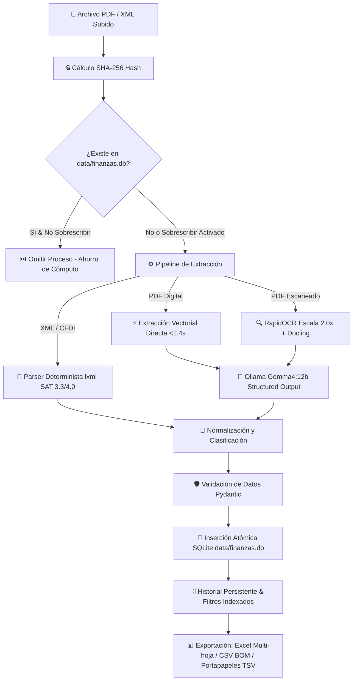

# 🏦 FinanceOCR — Extractor Financiero Local (PDF & XML)

Aplicación web **100% local y orientada a la privacidad** para extraer, normalizar, clasificar, validar y almacenar movimientos bancarios desde estados de cuenta en **PDF** (digitales y escaneados) y facturas o estados **XML** (CFDI SAT y estructuras bancarias genéricas).

Sin llamadas a internet, sin telemetría y sin APIs comerciales de terceros.

---

## 🏛️ Arquitectura del Sistema y Flujo de Datos



---

## 🚀 Características Principales

1. **Privacidad Total (100% Local):**
   - Todos los documentos y datos se procesan exclusivamente en la máquina del usuario.
   - Inferencia con LLM local mediante **Ollama** (`gemma4:12b`) con temperatura `0.0` y esquemas forzados por **Pydantic**.

2. **Almacenamiento Persistente en SQLite (`data/finanzas.db`):**
   - Guardado automático e inmediato de transacciones extraídas en base de datos local embebida.
   - Relaciones íntegras con claves foráneas en cascada (`ON DELETE CASCADE`) y modo **WAL** (*Write-Ahead Logging*) para concurrencia limpia en Streamlit.

3. **Detección Criptográfica de Duplicados (SHA-256):**
   - Previene el reprocesamiento innecesario de estados de cuenta ya analizados.
   - Badges contextuales de estado: 🟢 `Nuevo (Listo para procesar)` vs 🟡 `Ya procesado el DD/MM/AAAA`.
   - Control de omisión automática o re-procesamiento forzado con reemplazo limpio (`overwrite=True`).

4. **Pestaña Fija de Historial y Consulta:**
   - Accesible en todo momento desde el inicio sin necesidad de cargar archivos.
   - **Filtros combinados:** Rango de fechas (desde/hasta), buscador por palabras clave en concepto o descripción, filtro por flujo (Ingresos, Egresos o Todos) y selector por estado de cuenta fuente.
   - **Métricas dinámicas en vivo:** Recálculo automático de Ingresos, Egresos y Balance Neto del subconjunto filtrado.
   - **Exportación personalizada:** Descarga de los resultados filtrados en Excel (.xlsx con pestañas), CSV y Portapapeles (TSV listo para pegar con `Ctrl+V`).
   - **Auditoría y Gestión:** Panel para auditar estados de cuenta cargados y purgar en cascada cualquier archivo importado por error.

5. **Extracción Híbrida y OCR Optimizado (Docling + pypdfium2):**
   - **Pre-flight Heurístico (<10ms):** Detección automática instantánea de capas de texto vectorial vs escaneos rasterizados. Si el estado de cuenta es digital nativo, omite OCR logrando una velocidad **10x superior (~1.4s por documento)**.
   - **Caché Singleton de Modelos:** Reutiliza pesos y tokenizadores en memoria.
   - **RapidOCR Integrado con Escala Optimizada (2.0x):** Nitidez y bajo consumo de RAM.
   - **Visor e Inspector de Páginas:** Vista previa interactiva de las páginas y selección de rangos para omitir páginas de publicidad o términos legales.
   - **TableFormer Multihilo:** Configuración de hilos de CPU dinámicos (hasta 12 hilos) y selección entre modo Alta Velocidad (`FAST`) y Alta Precisión (`ACCURATE`).

6. **Procesamiento Determinista de XML (CFDI SAT 3.3 y 4.0):**
   - Lectura ultrarrápida con `lxml` reconociendo `cfdi:Comprobante`, `cfdi:Emisor`, `cfdi:Receptor` y `cfdi:Conceptos`.

7. **Normalización de Fechas en Español:**
   - Convierte automáticamente formatos bancarios como `15/01/2024`, `15 ENE 24`, `03-MAR-2025`, `28 de febrero del 2024` o `15 DE ENERO DE 2024` al estándar internacional **`YYYY-MM-DD`**.

8. **Integración Directa con Excel:**
   - **Botón Copiar al Portapapeles (TSV):** Copia los datos para pegarlos directamente con `Ctrl + V` en cualquier celda de Microsoft Excel o Google Sheets.
   - **Descarga en Excel (.xlsx):** Genera un libro con hojas independientes para **Ingresos** y **Egresos**.
   - **Descarga en CSV:** Archivos exportables con codificación UTF-8 con BOM para correcta visualización de acentos y eñes en Windows.

9. **Puntos de Control (Checkpoints) y Reanudación Automática:**
   - Registro atómico de progreso en base de datos SQLite y redundancia en archivo JSON.
   - Si un lote de procesamiento se interrumpe o falla, el sistema resguarda el avance previo y permite reanudar con un clic (`🔄 Reanudar automáticamente donde se quedó`) sin recalcular los documentos ya finalizados.
   - Reintentos automáticos con retroceso exponencial (`exponential backoff`) en inferencias con Ollama.

10. **Resguardo Físico y Visor Integrado de Documentos:**
    - Los estados de cuenta y facturas procesadas se guardan de forma permanente y segura en disco local (`data/documentos/`) con prefijos hash SHA-256 anticolisión.
    - Visor contextual de documentos integrado en la interfaz: inspección visual de páginas PDF con zoom de renderizado y visor de código XML con resaltado de sintaxis y descarga.

---

## 🛡️ Matriz de Validación de Datos e Integridad

| Dimensión | Mecanismo de Validación | Comportamiento / Garantía |
|---|---|---|
| **Importes Monetarios** | Pydantic `@field_validator("importe", mode="before")` | Limpia `$`, `MXN`, `USD`, comas de miles y espacios. Convierte negativos y positivos a valor absoluto positivo estricto (`float`). Valores inválidos o vacíos normalizan a `0.0`. |
| **Tipo de Flujo** | `TipoTransaccion(str, Enum)` + SQLite `CHECK(tipo IN ('ingreso', 'egreso'))` | Solo permite `'ingreso'` o `'egreso'`. Valores ilegales disparan `ValidationError` a nivel modelo y `sqlite3.IntegrityError` a nivel base de datos. |
| **Campos Obligatorios** | Pydantic Schema (`fecha`, `concepto`, `importe`, `tipo`) | Ausencia de cualquier campo requerido bloquea la creación del registro antes de tocar la base de datos. |
| **Integridad Relacional** | SQLite `PRAGMA foreign_keys = ON;` + `ON DELETE CASCADE` | No se pueden insertar transacciones huérfanas sin archivo padre válido. Al eliminar un estado de cuenta, todas sus transacciones se purgan en cascada. |
| **Transaccionalidad Atómica** | `db_session()` context manager con `BEGIN / COMMIT / ROLLBACK` | Si un error ocurre durante una inserción en lote (batch), se revierte toda la transacción. Cero escrituras parciales. |
| **Inyección SQL** | Parámetros sanitizados `?` en todas las cláusulas | Las búsquedas por concepto, fechas o IDs nunca concatenan cadenas SQL crudas. Cero vulnerabilidades a inyección. |
| **Fechas Bancarias** | Regex multiformato en `date_utils.py` | Soporta los 12 meses en abreviaturas y nombres completos, preposiciones `de` y `del`, formatos `DD/MM/YYYY`, `DD-MM-YY` e ISO 8601. |
| **Exportación Excel / CSV** | UTF-8 con BOM (`\xef\xbb\xbf`) y openpyxl multi-hoja | Garantiza que Windows y Excel abran acentos (`á`, `é`, `í`, `ó`, `ú`) y `ñ` sin caracteres corruptos. |

---

## 🗄️ Esquema de la Base de Datos SQLite (`data/finanzas.db`)

```sql
PRAGMA foreign_keys = ON;

-- Tabla de Estados de Cuenta / Archivos Procesados
CREATE TABLE IF NOT EXISTS archivos_procesados (
    id INTEGER PRIMARY KEY AUTOINCREMENT,
    nombre_archivo TEXT NOT NULL,
    hash_sha256 TEXT NOT NULL UNIQUE,
    tipo_archivo TEXT NOT NULL,           -- 'pdf' o 'xml'
    fecha_procesamiento TEXT NOT NULL,     -- Formato ISO: YYYY-MM-DD HH:MM:SS
    total_transacciones INTEGER NOT NULL DEFAULT 0,
    rango_fecha_inicio TEXT,              -- YYYY-MM-DD
    rango_fecha_fin TEXT                  -- YYYY-MM-DD
);

-- Tabla de Transacciones Individuales
CREATE TABLE IF NOT EXISTS transacciones (
    id INTEGER PRIMARY KEY AUTOINCREMENT,
    archivo_id INTEGER NOT NULL,
    fecha TEXT NOT NULL,                   -- YYYY-MM-DD
    concepto TEXT NOT NULL,
    importe REAL NOT NULL,
    descripcion TEXT,
    tipo TEXT NOT NULL CHECK(tipo IN ('ingreso', 'egreso')),
    FOREIGN KEY (archivo_id) REFERENCES archivos_procesados(id) ON DELETE CASCADE
);

-- Índices B-Tree para consultas de baja latencia (<5ms)
CREATE INDEX IF NOT EXISTS idx_transacciones_fecha ON transacciones(fecha);
CREATE INDEX IF NOT EXISTS idx_transacciones_concepto ON transacciones(concepto);
CREATE INDEX IF NOT EXISTS idx_transacciones_tipo ON transacciones(tipo);
CREATE INDEX IF NOT EXISTS idx_transacciones_archivo ON transacciones(archivo_id);
CREATE INDEX IF NOT EXISTS idx_archivos_nombre ON archivos_procesados(nombre_archivo);
CREATE INDEX IF NOT EXISTS idx_archivos_hash ON archivos_procesados(hash_sha256);
```

---

## 🧪 Suites de Pruebas Automatizadas

El proyecto cuenta con **40 pruebas automatizadas** divididas en suites modulares con fixtures organizados:

1. **`test_data_validation.py` (10 tests):**
   - Validación de límites de modelos Pydantic y sanitización de importes.
   - Enforzamiento estricto del Enum `TipoTransaccion`.
   - Restricciones SQLite `CHECK` y claves foráneas.
   - Reversión atómica (*rollback*) ante fallos en lotes.
   - Inmunidad a inyecciones SQL en consultas y filtros.
   - Matriz exhaustiva de normalización de fechas bancarias en español (12 meses, mayúsculas, minúsculas, `del 2024`).
   - Integridad estructural de exportaciones (Excel PK ZIP, CSV con BOM y TSV sin columnas internas).

2. **`test_database.py` (7 tests):**
   - Inicialización de esquemas e índices B-Tree.
   - Hashing determinista SHA-256.
   - Detección de duplicados y metadatos asociados.
   - Guardado y sobrescritura atómica (`overwrite=True`).
   - Eliminación en cascada de transacciones hijas.
   - Consultas con filtros multicriterio (fechas, conceptos, tipos, IDs).
   - Cálculo de métricas agregadas globales.

3. **`test_ocr_optimization.py` (4 tests):**
   - Caché singleton del conversor de documentos Docling.
   - Pre-flight de detección de capas vectoriales vs escaneadas en <10ms.
   - Filtrado y respeto estricto de rangos de páginas seleccionadas.
   - Renderizado visual de páginas PDF para el visor interactivo.

4. **`test_system.py` (16 tests):**
   - Normalización de fechas y saneamiento de importes.
   - Parser determinista de XML CFDI 4.0 SAT (facturas e ingresos).
   - Complemento Estado de Cuenta Bancario (`ecb:EstadoDeCuentaBancario`).
   - Complemento de Recepción de Pagos (`pago20:Pagos`).
   - Addenda Bancaria Débito y Crédito (HSBC México y banca comercial).
   - Fixtures de prueba oficiales en `tests/fixtures/` (`dummy_xml_debito.xml` y `dummy_xml_credito.xml`).
   - Formatos bancarios OFX (`<STMTTRN>`) y CAMT.053 ISO 20022 (`<Ntry>`).
   - Generación de libros Excel multi-hoja y TSV.
   - Limpieza y parseo de respuestas de LLM (markdown fences, tokens `<think>`).
   - Detección y filtrado de tablas y preservación de encabezados.

5. **`test_telemetry.py` (3 tests):**
   - Estructura y reporte de métricas de telemetría y recursos del sistema.
   - Ciclo de vida y cronómetro de fases (`StageStopwatch`).

### Directorio de Fixtures de Prueba (`tests/fixtures/`)
- `tests/fixtures/dummy_xml_debito.xml`: CFDI con Addenda de cuenta de débito (3 movimientos).
- `tests/fixtures/dummy_xml_credito.xml`: CFDI con Addenda de tarjeta de crédito (5 movimientos: 2 pagos y 3 consumos fiscales).
- `tests/fixtures/__init__.py`: Módulo utilitario con función `get_fixture_path()`.

### Ejecución de Pruebas

Para ejecutar la suite completa de 40 pruebas:

```powershell
.\.venv\Scripts\python -m unittest discover -v
```

Para ejecutar suites específicas:

```powershell
# Validación de datos y reglas de negocio
.\.venv\Scripts\python -m unittest test_data_validation.py -v

# Persistencia y base de datos
.\.venv\Scripts\python -m unittest test_database.py -v

# Extracción y optimización OCR
.\.venv\Scripts\python -m unittest test_ocr_optimization.py -v
```

---

## 🛠️ Requisitos Previos

1. **Python 3.10 o superior** (Detectado: Python 3.13 en Windows).
2. **Ollama instalado y ejecutándose localmente:**
   - Descarga gratuita desde [ollama.com](https://ollama.com).
   - Abre una terminal y descarga el modelo recomendado:
     ```bash
     ollama pull gemma4:12b
     ```
   - Verifica que Ollama esté activo en segundo plano (por defecto en `http://localhost:11434`).

---

## 💻 Puesta en Marcha

Inicia la aplicación web Streamlit ejecutando en PowerShell:

```powershell
.\.venv\Scripts\streamlit run app.py
```

La aplicación se abrirá automáticamente en tu navegador web en:
`http://localhost:8501`
