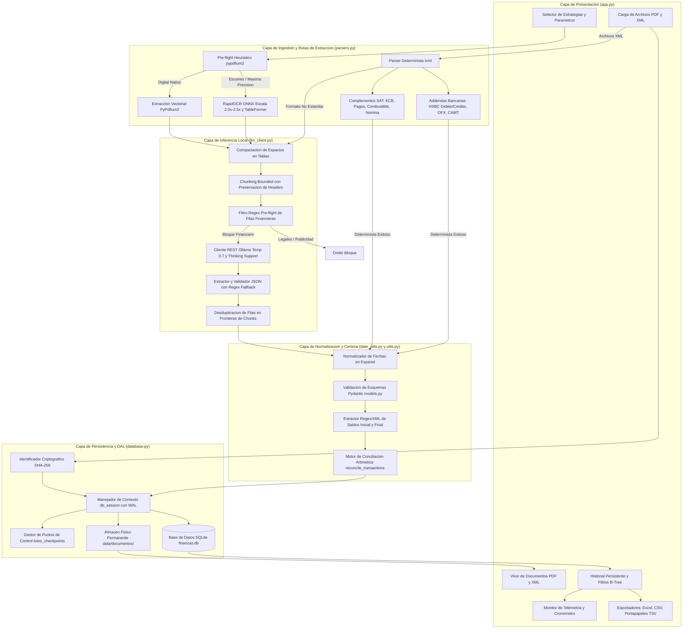

# Arquitectura del Sistema FinanceOCR

Este documento describe la arquitectura tecnica, el modelo de datos, la interaccion entre componentes y los patrones de diseno implementados en FinanceOCR.

---

## 1. Filosofia de Diseno y Principios Rectores

FinanceOCR esta disenado para operaciones financieras criticas bajo cuatro principios inmutables:

1. **Privacidad Absoluta (Zero Cloud Egress):**
   - El procesamiento de documentos bancarios, comprobantes fiscales y estados de cuenta se ejecuta estrictamente en el entorno local del usuario.
   - No se emiten llamadas a APIs comerciales externas ni telemetria remota.
   - La inferencia de lenguaje natural se apoya exclusivamente en instancias locales de Ollama sobre el puerto local (127.0.0.1:11434).

2. **Arquitectura Hibrida de Doble Riel (Deterministic First, LLM Fallback):**
   - Siempre que un formato cuente con estructura de datos predecible (XML CFDI, complementos SAT, addendas bancarias, OFX o CAMT), el sistema ejecuta extraccion determinista pura con latencia minima (menor a 50ms) y precision matematica del 100%.
   - La inferencia con modelos de lenguaje local se reserva para documentos con disposicion visual libre (PDFs escaneados o nativos) o estructuras XML anomalas.

3. **Certeza Contable y Verificacion Matematica:**
   - La validez de una extraccion no se asume ciegamente; se somete a conciliacion aritmetica contra los saldos de apertura y cierre declarados en el documento.

4. **Tolerancia a Fallos y Reanudacion Transaccional:**
   - Los lotes extensos cuentan con puntos de control (checkpoints) incrementales. Si ocurre una interrupcion de hardware o timeout, el trabajo previo no se pierde y puede reanudarse de inmediato.

---

## 2. Diagrama de Arquitectura y Flujo de Interaccion



---

## 3. Descomposicion Modular del Sistema

### 3.1. app.py (Capa de Presentacion y Orquestacion)
Es el punto de entrada de la aplicacion desarrollado sobre Streamlit.
- **Configuracion y Barra Lateral:**
  - Control de conexion al servidor Ollama, seleccion de modelo y ventana de contexto (hasta 32,768 tokens).
  - Selector global de estrategias de extraccion para PDF y XML con definicion de RFC del titular.
- **Pestana 1: Extractor y Procesamiento:**
  - Componente expandible de telemetria en tiempo real.
  - Carga masiva de documentos (.pdf y .xml) con verificacion criptografica SHA-256 instantanea.
  - Acordeones contextuales por archivo para configuracion de estrategias individuales, asignacion de modelo LLM, modo de tablas, escala OCR y seleccion de rangos de pagina con vista previa visual interactiva.
  - Deteccion de puntos de control activos con tarjetas de recuperacion para reanudar lotes interrumpidos.
  - Panel de resultados inmediatos con metricas contables, informe visual de conciliacion de saldos y descarga directa.
- **Pestana 2: Historial y Consulta de Transacciones:**
  - Consulta directa sobre la base de datos local SQLite mediante consultas indexadas.
  - Barra de herramientas con filtros combinados: rango de fechas (desde/hasta), tipo de flujo (Ingresos, Egresos, Todos), selector de estado de cuenta de origen y buscador textual.
  - Visor contextual de documentos almacenados para auditoria fisica.
  - Botones de exportacion: Excel multi-hoja (.xlsx), CSV con BOM y boton interactivo JavaScript para copiar en formato TSV (Ctrl + V directo a Excel).
  - Seccion de auditoria y purga con eliminacion en cascada.

### 3.2. parsers.py (Motores de Extraccion Hibridos)
Encapsula la logica de conversion de formatos fisicos y sintacticos a estructuras financieras.
- **Inspeccion Heuristica de PDFs (detect_pdf_profile):**
  - Utiliza `pypdfium2` para inspeccionar el documento en menos de 10ms.
  - Calcula la densidad de caracteres por pagina. Si el promedio supera el umbral (60 caracteres/pagina), clasifica el archivo como digital nativo; de lo contrario, lo marca como escaneo que requiere OCR.
- **Cache Singleton de Convertidores (get_cached_converter):**
  - Mantiene un registro en memoria (`_CONVERTERS_CACHE`) indexado por la tupla `(enable_ocr, accurate_tables, num_threads, ocr_scale)`.
  - Evita reinicializaciones costosas de pesos y tokenizadores ONNX de RapidOCR y Docling TableFormer.
- **Pipeline PDF (parse_pdf):**
  - Permite procesar rangos de paginas especificos `page_range=(start, end)`.
  - Configura TableFormer en modo `FAST` (baja latencia) o `ACCURATE` (multi-pasada para celdas fusionadas).
- **Parser Determinista XML (parse_xml):**
  - Emplea `lxml.etree` con parser seguro sin resolucion de entidades externas.
  - Inspecciona CFDI SAT 3.2, 3.3 y 4.0; Complemento Estado de Cuenta Bancario (`ecb:EstadoDeCuentaBancario`); Complemento de Pagos (`pago10`/`pago20:Pagos`); Estado de Cuenta Combustible (`ecc11`/`ecc12`); Nomina (`nomina12:Nomina`); y Addendas bancarias especializadas (HSBC debito y credito con tags `MovimientoDelClienteFiscal`).
  - Procesa archivos internacionales OFX/QFX (`<STMTTRN>`) y CAMT ISO 20022 (`<Ntry>`).
  - Convierte formatos tabulares como Excel SpreadsheetML y XML generico a tablas Markdown estructuradas.
  - Como ultimo recurso ante esquemas desconocidos, genera una representacion jerarquica indentada preservando atributos y relaciones padre-hijo.
- **Resolutores de Estrategias:**
  - `resolve_pdf_strategy`: Resuelve la herencia entre la configuracion global y los ajustes individuales del archivo.
  - `resolve_xml_strategy`: Determina si el archivo se procesa en modo determinista estricto, hibrido con fallback o forzado a LLM.
- **Extractor de Saldos (extract_statement_balances):**
  - Localiza saldos de apertura y cierre mediante expresiones regulares y atributos XML en el contenido del documento.

### 3.3. llm_client.py (Cliente REST Local y Pipeline de Inferencia)
Gestiona la comunicacion robusta con Ollama y la preparacion de texto.
- **Compactacion de Tablas (compact_markdown_tables):**
  - Remueve el relleno excesivo de espacios en blanco generado por TableFormer, reduciendo la densidad de caracteres por linea en mas de un 80% y optimizando la ventana de contexto.
- **Bounded Chunking con Preservacion de Headers (chunk_text):**
  - Segmenta el texto en bloques controlados (`max_chunk_chars=1800`, `max_table_rows=6`).
  - Si una tabla se divide a traves de multiples fragmentos, inyecta automaticamente las filas de encabezado originales en cada fragmento resultante, impidiendo que el LLM confunda columnas de cargo y abono.
- **Filtro Pre-Flight de Filas Financieras (chunk_has_transaction_rows):**
  - Evalua con regex la concurrencia de fechas y montos monetarios en cada bloque.
  - Descarta fragmentos no financieros (avisos legales, publicidad, clausulas contractuales) con costo computacional nulo, reduciendo el tiempo total de procesamiento en mas de un 70%.
- **Parametros de Inferencia:**
  - Temperatura `0.7`: Evita bucles repetitivos y bloqueos de muestreo codicioso observados a temperatura 0.0 en modelos modernos de razonamiento.
  - Contexto de ano (`extract_statement_year`): Inyecta el ano del documento en el prompt del sistema para desambiguar fechas sin ano.
- **Parseo Resiliente de JSON (clean_and_parse_llm_json):**
  - Filtra etiquetas de pensamiento (`<think>...</think>`) generadas por modelos como DeepSeek-R1 o Qwen.
  - Extrae bloques de codigo markdown y aplica expresiones regulares de rescate para recuperar objetos transaccionales en caso de respuestas parcialmente truncadas.
- **Desduplicacion de Fronteras:**
  - Compara las llaves transaccionales del fragmento actual contra el fragmento previo para omitir duplicados derivados de la division de chunks, preservando movimientos legitimate del mismo dia.
- **Manejo de Reintentos:**
  - Implementa retroceso exponencial (hasta 3 reintentos) ante errores de conexion o codigos HTTP 429/5xx.

### 3.4. database.py (Capa de Acceso a Datos y Persistencia)
Provee persistencia confiable y libre de bloqueos en SQLite.
- **Modo WAL y Foreign Keys:**
  - Inicializa SQLite con `PRAGMA journal_mode = WAL;`, `PRAGMA synchronous = NORMAL;` y `PRAGMA foreign_keys = ON;`.
  - Permite lecturas y escrituras concurrentes sin colisiones con la interfaz de Streamlit.
- **Ciclo de Vida de Sesion Seguro (db_session):**
  - Manejador de contexto con confirmacion (`commit`) y reversion automatica (`rollback`) ante excepciones, garantizando el cierre explicito de conexiones.
- **Deteccion Criptografica de Duplicados (compute_file_hash):**
  - Genera firmas SHA-256 sobre el contenido binario crudo del archivo.
  - Previene inserciones redundantes y soporta el modo de sobrescritura atomica (`overwrite=True`).
- **Resguardo Fisico Permanente de Documentos:**
  - `save_document_file`: Almacena una copia del archivo cargado en `data/documentos/` prefijado con los primeros 16 caracteres de su hash SHA-256 (`{hash[:16]}_{safe_name}`).
  - `delete_processed_file`: Al suprimir un estado de cuenta, elimina sus transacciones en cascada en la base de datos y borra de forma sincronizada el archivo fisico en disco.
- **Sistema de Puntos de Control (Checkpoints):**
  - Registra el estado de lotes en la tabla `lotes_checkpoints` y mantiene una copia de respaldo en `data/checkpoint_active.json`.
  - Gestiona transiciones de estado: `in_progress`, `interrupted` y `completed`.
- **Migraciones Automaticas No Destructivas:**
  - Inspecciona y anade de manera transparente columnas requeridas (`ruta_archivo`, `tamano_bytes`, `saldo_inicial`, `saldo_final`, `diferencia_conciliacion`, `conciliado`) sin requerir intervencion manual.

### 3.5. models.py (Modelos de Dominio y Validacion Canónica)
Define los contratos de datos mediante Pydantic v2.
- **TipoTransaccion (Enum):**
  - Define estrictamente los flujos permitidos: `ingreso` y `egreso`.
- **Transaccion (BaseModel):**
  - Campos: `fecha` (ISO YYYY-MM-DD), `concepto`, `importe`, `descripcion`, `tipo`.
  - `@field_validator("importe", mode="before")`: Sanitiza formatos contables con signo negativo posterior, parentesis de debito, simbolos de moneda y sufijos bancarios (`CR`, `DR`, `CARGO`, `ABONO`), transformando el valor en un numero flotante positivo estricto.
- **TransaccionesResponse (BaseModel):**
  - Contenedor para extraccion estructurada por lotes.
- **ReconciliacionResultado (BaseModel):**
  - Encapsula los calculos de verificacion contable: saldo inicial, saldo final declarado, saldo final calculado, totales de ingresos y egresos, diferencia absoluta, indicador booleano de conciliacion y modo de calculo (`debito` o `credito`).

### 3.6. date_utils.py (Normalizacion de Fechas en Espanol)
- **normalize_spanish_date:**
  - Convierte multiples variantes de fechas financieras bancarias al estandar ISO 8601 (`YYYY-MM-DD`).
  - Reconoce abreviaturas y nombres completos de los 12 meses en espanol, variantes con conectores (`de`, `del`), formatos compactos (`YYYYMMDD`) y fechas con marca de tiempo.
  - Valida la existencia de la fecha en el calendario gregoriano descartando dias invalidos.
- **extract_statement_year:**
  - Analiza encabezados y textos preliminares del estado de cuenta para extraer el ano fiscal de corte (2015-2035) y proveerlo como valor de respaldo cuando las tablas bancarias solo imprimen dia y mes.

### 3.7. telemetry.py (Monitoreo de Recursos y Cronometria)
- **get_system_metrics:**
  - Captura metricas instantaneas de hardware en menos de 50ms sin emitir peticiones externas.
  - CPU: Carga porcentual, nucleos fisicos e hilos logicos via `psutil`.
  - RAM: Memoria total, usada, libre y porcentaje.
  - GPU: Deteccion de tarjetas NVIDIA compatibles mediante ejecucion segura de `nvidia-smi` en subproceso, reportando utilizacion, VRAM y temperatura.
- **StageStopwatch:**
  - Cronometro modular que registra el tiempo exacto consumido en cada etapa del pipeline (extraccion documental, inferencia LLM, persistencia).
- **render_telemetry_expander:**
  - Renderiza el panel visual colapsable en la interfaz con barras de progreso y comparativa porcentual de tiempos.

### 3.8. utils.py (Utilidades de Exportacion y Conciliacion)
- **create_standard_dataframe:**
  - Convierte listas de objetos `Transaccion` en un `pandas.DataFrame` ordenado cronologicamente con nombres de columna estandarizados.
- **df_to_excel_bytes:**
  - Genera libros de trabajo Excel (.xlsx) con hojas independientes para `Ingresos` y `Egresos` empleando `openpyxl`.
- **df_to_tsv y df_to_csv_bytes:**
  - Genera cadenas TSV sin indice de fila para copiado directo a Excel y archivos CSV codificados en `UTF-8 con BOM` (`utf-8-sig`) para correcta visualizacion de caracteres especiales en Windows.
- **render_clipboard_button:**
  - Inyecta un boton HTML/JavaScript personalizado que interactua directamente con la API `navigator.clipboard` del navegador para copiar datos al portapapeles con retroalimentacion visual.
- **reconcile_transactions:**
  - Ejecuta la conciliacion aritmetica evaluando simultaneamente las ecuaciones de cuenta de cheques/debito y de tarjeta de credito, seleccionando el modo con menor discrepancia y validando si la diferencia se encuentra dentro de la tolerancia estricta (menor o igual a $0.05).

---

## 4. Esquema Relacional de Base de Datos

```
+--------------------------------------------------------------------------+
|                          archivos_procesados                             |
+--------------------------------------------------------------------------+
| id                       INTEGER PRIMARY KEY AUTOINCREMENT               |
| nombre_archivo           TEXT NOT NULL                                   |
| hash_sha256              TEXT NOT NULL UNIQUE                            |
| tipo_archivo             TEXT NOT NULL ('pdf' | 'xml')                   |
| fecha_procesamiento      TEXT NOT NULL (YYYY-MM-DD HH:MM:SS)             |
| total_transacciones      INTEGER NOT NULL DEFAULT 0                      |
| rango_fecha_inicio       TEXT (YYYY-MM-DD)                               |
| rango_fecha_fin          TEXT (YYYY-MM-DD)                               |
| ruta_archivo             TEXT                                            |
| tamano_bytes             INTEGER                                         |
| saldo_inicial            REAL                                            |
| saldo_final              REAL                                            |
| diferencia_conciliacion  REAL                                            |
| conciliado               INTEGER (1, 0, NULL)                            |
+--------------------------------------------------------------------------+
                                     |
                                     | 1
                                     |
                                     | N (ON DELETE CASCADE)
                                     v
+--------------------------------------------------------------------------+
|                             transacciones                                |
+--------------------------------------------------------------------------+
| id                       INTEGER PRIMARY KEY AUTOINCREMENT               |
| archivo_id               INTEGER NOT NULL (FK -> archivos_procesados.id) |
| fecha                    TEXT NOT NULL (YYYY-MM-DD)                      |
| concepto                 TEXT NOT NULL                                   |
| importe                  REAL NOT NULL                                   |
| descripcion              TEXT                                            |
| tipo                     TEXT NOT NULL CHECK(tipo IN ('ingreso','egreso'))|
+--------------------------------------------------------------------------+

+--------------------------------------------------------------------------+
|                           lotes_checkpoints                              |
+--------------------------------------------------------------------------+
| batch_id                 TEXT PRIMARY KEY                                |
| estado                   TEXT NOT NULL ('in_progress','interrupted',...) |
| archivos_totales         INTEGER NOT NULL                                |
| archivos_completados     TEXT NOT NULL (JSON Array)                      |
| archivo_fallido          TEXT                                            |
| ultimo_error             TEXT                                            |
| configuraciones          TEXT (JSON Object)                              |
| fecha_actualizacion      TEXT NOT NULL (YYYY-MM-DD HH:MM:SS)             |
+--------------------------------------------------------------------------+
```

---

## 5. Modelo de Seguridad e Integridad

1. **Aislamiento de Entorno:** Todas las operaciones ocurren en memoria y en almacenamiento local. Ningun dato financiero es transmitido a la red.
2. **Inmunidad a Inyeccion SQL:** Todas las consultas en `database.py` utilizan marcadores de posicion (`?`) con paso estricto de tuplas de parametros; no existe interpolacion directa de cadenas SQL.
3. **Integridad Referencial:** La aplicacion activa `PRAGMA foreign_keys = ON;`. La eliminacion de cualquier archivo desencadena la purga en cascada de sus transacciones hijas sin dejar registros huerfanos.
4. **Proteccion contra Fallos de Concurrencia:** La activacion del modo WAL (`Write-Ahead Logging`) en SQLite previene bloqueos de base de datos durante lecturas desde el visor de historial mientras se procesan lotes en segundo plano.
